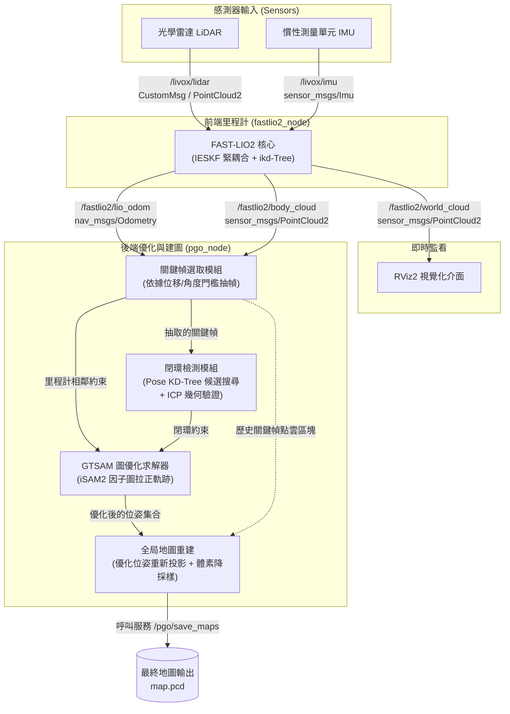

## PGO 與存圖細節

- PGO 從 `/fastlio2/body_cloud` 與 `/fastlio2/lio_odom` 選關鍵幀，以 KD-tree 搜尋先前位姿，用 ICP 對局部子圖驗證候選，再以 GTSAM iSAM2 優化位姿圖。閉環以位姿鄰近為候選，所以目前軌跡必須回到先前位置的搜尋半徑內才可能驗證成功。
- PGO 仍發布 `map` 到 `lidar` 的校正 TF，但 RViz 的 fixed frame 固定為 `lidar`，避免 PGO 的 TF 延遲擋住即時點雲。
- `docker/build_workspace.sh` 建置上游 PGO 時會套用 `patches/fastlio2-pgo-sync.patch`：精確比對點雲與里程計時間戳、模擬時鐘重置時恢復、原子取用最新佇列量測，並記錄接受的關鍵幀與閉環；建置後 submodule 會還原，維持乾淨。
- `save_map.sh` 寫入 `map.pcd`、`poses.txt` 與（選用）`patches/`。寫入 `map.pcd` 前套用 `src/FASTLIO2_ROS2/pgo/config/pgo.yaml` 的 `save_map_resolution`（預設 0.1 m）；`--voxel-size` 只覆寫該次執行，設為 `0` 則不降採樣。`patches/` 內的檔案維持關鍵幀原解析度。`--save-patches` 預設為 `true`，`--output-dir` 預設 `maps/office`。

## 分樓層建圖管理器

逐步操作、電梯換層與故障排除見[建圖管理器使用指南](mapping_manager.md)。

`run_slam.sh` 啟動模擬、RViz 與容器內的 `scripts/mapping_manager.py serve`，管理器起始為 `idle`，不立即啟動 FAST-LIO2。控制介面是本機 Unix socket，由 `scripts/slam_session.sh` 透過現有 ROS container 呼叫；主機不需安裝 rclpy，也不需重新建置 workspace 或 image。

```bash
# 第一個終端；保持運行
./scripts/run_slam.sh
# 第二個終端；模擬須保持播放，初始化時車子需停穩
./scripts/slam_session.sh start floor_ground
./scripts/slam_session.sh status
./scripts/slam_session.sh save-stop
# 建圖停止後搭電梯；出電梯並停穩後啟動新的 session
./scripts/slam_session.sh start floor_lower
./scripts/slam_session.sh save-stop
```

| 指令 | 行為 |
|---|---|
| `start FLOOR` | 只接受 1～64 個英數字、底線、連字號，第一字必須為英數字。建立新的 `maps/FLOOR`，啟動原有 `fastlio.launch.py`，等到 LIO 已輸出里程計、PGO 服務可用並取得時間接近的 simulator ground truth 才回覆 `mapping`。 |
| `save-stop` | 呼叫 `/pgo/save_maps`（含 patches），檢查服務成功、binary PCD 的點數／資料長度、poses 與 patches，寫入 metadata 後才停止受管理的建圖程序。RViz、Isaac Sim、電梯及 `/clock` 繼續運行。 |
| `status` | 回傳 JSON：目前狀態／session、上一個 session 與最近錯誤；指令失敗的 exit code 為非零。 |

每層目錄包含 `map.pcd`、`poses.txt`、`patches/`、`session.json`、`slam.log`。已存在的目錄一律拒絕，不覆寫舊圖；重掃時用新名稱，例如 `floor_lower_run2`。**每次 start 都是乾淨的新圖，不是載入或恢復上一個估計器**。不要只切斷感測器輸入來暫停 FAST-LIO，也不要在同一個 session 中搭電梯換樓層。第一版僅支援 `run_slam.sh` 的單台預設 Nova Carter，沒有按鍵綁定或自動判斷樓層。

`session.json` 記錄樓層 ID、啟動／存圖／停止時間、點數、初始 LIO 位姿、時間接近的 Isaac chassis ground truth 與 Nova Carter 感測器外參。這些是**座標參考資料，不是已完成配準的 PGO 地圖到 Isaac world 變換**，也不會自動將每層原點統一或切換 Nav2 地圖。PCD 的 z 軸以該 session 的 LIO／PGO 座標為準，不能直接把地下樓層的模擬高度 `-3.3 m` 當成投影高度範圍；請量測該層 PCD 中的地板高度後設定 `pcd2pgm.py` 的 z 範圍。

初始化逾時（30 秒）會停止該次建圖，保留失敗目錄與 `slam.log`，改用新樓層名稱重試。存圖失敗、空圖或輸出檔案不完整時，則保留建圖程序與目前資料，查 `status` 後重試 `save-stop`；若服務回覆逾時，重試會等候同一個尚未完成的請求，避免重複存圖。管理器只關閉自己啟動的 process group，不按程序名稱殺掉其他 ROS 工作；已有另一套 mapping 節點時拒絕啟動。指令序列化處理，`status` 在另一個長指令執行時會等待它結束。

`save_map.sh` 仍是獨立快照工具，不負責停止或切換 session，預設路徑仍是 `maps/office`。離開 `run_slam.sh`／關閉模擬前，先執行 `save-stop`；退出時不自動存圖。管理器可清除舊 PGO 閉環標記，但 RViz 世界點雲顯示仍可能保留最多 10 秒的舊點；換圖時可在 RViz 按 Reset，這只是顯示快取，不代表新地圖包含舊樓層。

驗證：`PYTHONPATH=tests python3 -m unittest test_mapping_manager test_script_entrypoints`；實際 FAST-LIO2／PGO、兩個 session 存圖與重啟測試可用 `docker compose run --rm --no-deps -e ROS_DOMAIN_ID=119 ros python3 /workspace/tests/validate_mapping_manager.py`。請選擇未被其他 ROS 工作使用的 domain；整合測試用合成感測器資料及無 GUI 的 RViz 存活替身，僅清理自己建立的臨時測試地圖。

## PCD 轉 2D 地圖

`./scripts/pcd2pgm.py` 預設讀 `maps/office/map.pcd`，輸出 `maps/office/map_2d.pgm` 與 `map_2d.yaml`，投影 0.1–2.0 m 的點，解析度 0.05 m：

```bash
./scripts/pcd2pgm.py maps/office/map.pcd maps/office/map_2d \
  --z-min 0.1 --z-max 2.0 --resolution 0.05
```

`--min-points` 可剔除點數稀疏的格子，`--inflation` 擴大障礙物（通常交給 Nav2 costmap 處理較好），`--background unknown` 讓未占用格子保持未知。合併後的 PCD 只有障礙物回波、沒有原始光線，無法精確還原已觀測的空地與未知區，預設以空地為背景，與常見的 PCD 轉 PGM 工具一致。
