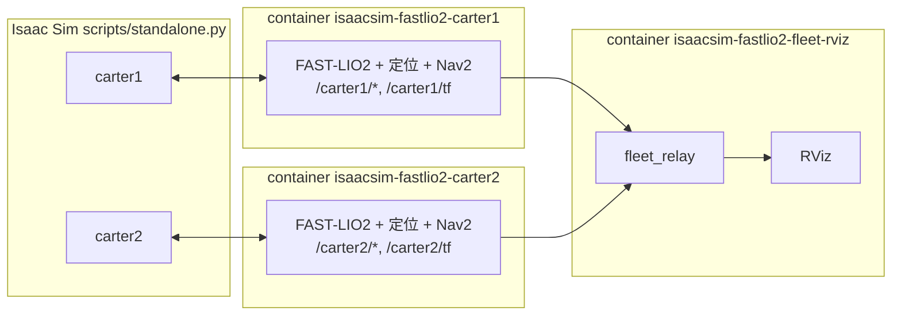

# 多車導航

一個腳本啟動 Isaac Sim、依參數生成 N 台車，每台車一個獨立的導航 container（與真車一車一台電腦相同），再加上一個顯示全部車輛的 RViz。

```bash
./scripts/run_multi_nav.sh                                   # Nova Carter + Carter v1
./scripts/run_multi_nav.sh --robot carter1@0,0 --robot carter2:carter_v1@3.5,0
./scripts/run_multi_nav.sh --headless --no-rviz              # 無 GUI
./scripts/run_multi_nav.sh --help
```

相機串流與 MQTT 等對外連線見[對外連線文件](online.md)（`run_multi_nav_online.sh`）。

車輛規格：`NAME[:TYPE][#FLEET]@X,Y[,YAW]`

- `NAME`：namespace，英數字與底線，不分大小寫不可重複（同時作為 Compose project 名稱）。
- `TYPE`：車種，對應 `config/robots/TYPE.yaml`，預設 `nova_carter`。
- `FLEET`：Open-RMF 車隊名稱（規則同 `NAME`），只有 `run_multi_nav_online.sh` 會用到（見[對外連線文件](online.md)），省略為 `default_fleet`。放在 `TYPE` 之後、`@` 之前，例如 `carter2:carter_v1#fleet2@3.5,0`。
- `X,Y,YAW`：Isaac world 位置（m）與 robot prim 航向（rad）；Office 地圖與 Isaac world 對齊，所以也是地圖座標。

不指定 `--robot` 時，預設為 `carter1:nova_carter@0,0,0` 與 `carter2:carter_v1@3.5,0,0`。按 Ctrl+C 會停止 Isaac 並移除所有 container。

兩種車都以差速驅動輪那端為車頭，正 `linear.x` 朝 USD +x 行駛。多於一台車時，Isaac viewport 固定在生成點中心上方俯視（右方 +X、上方 +Y，與 RViz 一致）；單車時維持跟車視角。

## 架構



- **一車一 container**：`slam_bringup` 的 `robot.launch.py robot:=NAME[:TYPE][#FLEET]@X,Y,YAW` 啟動單車完整堆疊，所有 topic、action、service 都在 `/NAME` 下。
- **每車獨立 TF 樹**：TF 重映射到 `/NAME/tf`、`/NAME/tf_static`，frame 名稱不變（`map`、`odom`、`base_link`…），各車設定檔與單車版本相同。
- **Fleet RViz**：`fleet_rviz.launch.py robots:="carter1;carter2"` 執行 `fleet_relay.py`，把各車 TF 與機體座標系 topic 轉發到 `/fleet/...` 並加上 `NAME/` 前綴；`map` 座標系的 topic（路徑、costmap、`odometry/global` 等）由 RViz 直接訂閱 `/NAME/...`。
- **Isaac 端**：`scripts/standalone.py --robot ...` 為每台車建立 `/NAME/...` 的 LiDAR、IMU、`cmd_vel`、輪速與 ground truth topic；`/clock` 只由第一台車發佈。

## 送導航目標

### 顯示樓層

Fleet Control 面板的 **Display floor (monitoring only)** 選單切換監控樓層。
兩個多車啟動腳本皆預設載入 `maps/1F/map_2d.yaml` 與 `maps/B1/map_2d.yaml`
所指定的 PGM，初始顯示 1F；不會自動加入 `office` 等其他地圖。
使用 `--map` 自訂起始地圖時，從該地圖上一層目錄取得 1F／B1，並包含起始樓層。
即使該層沒有車，也能顯示底圖。
這只切換 RViz 畫面，**不會發送 MQTT 換層指令、改變車端地圖或移動電梯**。

每層底圖由 Fleet RViz 容器內獨立的 map server 發布：
`/fleet/maps/floor_N/map`（N 對應選單順序，從 0 開始）。
只顯示樓層符合選單且 `floor_transition_state` 為 `idle` 的車輛群組；
其他樓層、尚未確認樓層、準備／換圖中及失敗的車輛疊圖會隱藏。
切回時恢復原本的顯示開關，並清除舊的導航顯示快取。
這是單層本地 `map` 座標顯示，不會將兩層疊在一起。

導航目標與初始位姿工具僅對顯示樓層上的選中車輛開放；切換樓層會取消尚未完成的拖曳。
手動換圖正在等待位姿時，車端會透過 `navigation/initial_pose_floor` 告知可設定初始位姿的目標樓層；
選中該樓層後只開放 **Set initial pose**，導航保持停用。
若顯示「waiting for floor manager」，需確認該車的導航堆疊已啟動。

單獨啟動監控：

```bash
ros2 launch slam_localization_3d fleet_rviz.launch.py \
  robots:="carter1;carter2" maps_root:=/workspace/maps initial_floor:=1F \
  floors:="1F;B1"
```

`floors` 可在直接使用 launch 時指定其他監控樓層；缺少指定樓層的 YAML 會明確報錯。

修改面板後需重新編譯 `slam_localization_3d` 並重開 Fleet RViz。
驗證：`python3 -m unittest tests.test_fleet_floor_config`、
ROS 環境中的 `python3 -m unittest tests.test_fleet_floor_launch`，
以及 `./tests/run_fleet_panel.sh`（實際 RViz 操作測試）。

### 共用禁行／限速區

```bash
./scripts/run_multi_nav.sh --filter-editor                         # 也適用 run_multi_nav_online.sh
./scripts/run_multi_nav.sh --filter-editor --filter-state-dir DIR  # 預設 maps/costmap_filters/fleet
```

`run_multi_nav_lift_online.sh` 預設啟用，加 `--no-filter-editor` 可關閉；其他多車腳本預設不啟用。

每個監控樓層一份區域，所有車共用：Fleet RViz 容器為每層執行一個
`costmap_filter_editor.py`（namespace `/fleet/zones/floor_<樓層>`，
以該層 `/fleet/maps/floor_N/map` 為底圖），狀態存於 `DIR/<樓層>.json`。
操作方式與單車相同（見[導航文件](nav.md#costmap-filters禁行區與限速區)）：
Fleet Control 面板選擇顯示樓層後，**Publish Point** 與 **Costmap zone editor** 會自動切到該層。
更新即時套用到該層所有車，不需重啟。

車端（`fleet_filters:=true`）的 `floor_manager` 透過 `/NAME/costmap_filters/{keepout,speed}_info`
將 Keepout／Speed filter 指向目前樓層的 mask；換層時會在停車後等待目標樓層的 mask，
目標地圖載入後才切換，之後才恢復導航。若等不到 mask，換層失敗並保持停車（與其他換層失敗相同）。
啟動時，各車的 costmap 也會等待初始樓層的 mask。

- 樓層名稱只能包含英數字與底線（ROS topic 限制），例如 `B-1` 會報錯。
- `--no-rviz --filter-editor` 仍會啟動 Fleet RViz 容器（不開 RViz），只提供已保存的區域，無法編輯。
- 任一樓層 editor 異常結束會停止整個 Fleet RViz launch。
- 單車的 `filter_editor` 不能與 `fleet_filters` 同時使用。
- 真車：車端加 `fleet_filters:=true`（需 `navigate:=true`），監控端加 `fleet_rviz.launch.py filter_editor:=true [filter_state_dir:=DIR]`。

### 選擇車輛與目標

在 RViz 的 **Fleet Control** 面板選擇車輛，按 **Set navigation goal**，在地圖上按住左鍵拖曳設定目標與航向。**Set initial pose** 用來重設選中車輛的定位。工具列的 **2D Goal Pose／2D Pose Estimate** 也會使用目前選中的車輛。

或直接指定車輛的 action：

```bash
ros2 action send_goal /carter2/navigate_to_pose nav2_msgs/action/NavigateToPose \
  "{pose: {header: {frame_id: map}, pose: {position: {x: 3.5, y: -2.5}, orientation: {w: 1.0}}}}"
```

## 初始位姿

### Headless 模擬真值參考標記

多車腳本使用 `--manual-initial-pose` 時，在 Fleet RViz 顯示**黃色箭頭與 `車名 [SIM REF ~]` 標籤**，
位於 **Displays → Simulation reference (approximate)**，可自行取消勾選。
這組標記不需要車端先定位成功，也不受正式車輛疊圖隱藏影響；
選好車輛及樓層後，可依黃色箭頭大致位置與朝向，用 **Set initial pose** 拖曳設定先驗。
仍須等待 ICP 成功，並確認掃描與地圖對齊，才能相信正式的定位箭頭。
收到某台車有效的 `/NAME/initialpose` 後，立即清除該車的參考箭頭與標籤，
本次監控程序內不再出現；其他尚未設定的車輛繼續顯示。自動初始化模式不啟動參考標記節點，
也不顯示黃色箭頭；正式定位箭頭不受影響。

`fleet_ground_truth.py` 訂閱各車 `/NAME/isaac/ground_truth/odom`，
使用各層 `session.json` 的初始 LIO 位姿、Isaac chassis 位姿與建圖車 IMU 外參，
先依各車出生位置及朝向，將相對出生點的 odometry 換算為共同座標，
再換算至該層地圖、投影為平面箭頭。不能因 topic 標示 `isaac_world` 就省略出生點轉換。
兩個多車腳本會自動傳入完整 robot specs；若手動啟動 Fleet RViz，只提供車名而沒有
`@X,Y,YAW`，該車參考標記會停用並記錄警告，避免誤畫在共同原點。
樓層由真值高度與建圖參考高度判斷（預設容許差 0.75 m），不依賴尚未初始化的定位結果；
高度不符合、同時符合多層或超過 2 秒未收到真值時，移除該車參考標記。
切換顯示樓層時只顯示對應層的參考標記。

**`SIM REF ~` 只是近似參考，不是已校正的地圖真值，也不代表定位成功。**
建圖後的 PGO／地圖誤差仍可能造成偏差。
此節點只發布 `/fleet/maps/floor_N/simulation_reference`，不發布 TF、initial pose、
導航目標或定位觀測，也不會把 ground truth 融合進 EKF／ICP。
缺少或損壞 `session.json` 的樓層會記錄警告並停用參考標記，不會直接拿 world 座標當 map 座標。
ROS 環境中的驗證：`python3 -m unittest tests.test_fleet_ground_truth tests.test_fleet_floor_launch`。

### 定位初始化

`run_multi_nav.sh` 與 `run_multi_nav_online.sh` **預設自動為每台車發送一次初始位姿**，
在 `--headless --no-rviz` 下也有效，不需要逐車拉 pose。
`robot.launch.py` 使用各車出生位置、朝向與 IMU 外參，透過起始樓層的 `session.json`
換算成 `map → camera_init` 猜測；不會直接把 Isaac world 座標當成 1F 地圖座標。
`global_pose_adapter.py` 等待有效的新鮮 LIO odometry 以及 ICP 的 `global_localization`
訂閱者就緒，再發送各車 `/NAME/initialpose`（`map → base_link`）。
已收到手動 pose 時不覆蓋；換樓層時不重新發送出生位置。
這只是近似先驗，仍須等待 ICP 成功及掃描對齊，不能視為定位已完成。

加上 `--manual-initial-pose` 可關閉自動初始化，改用 RViz。
非 Office 地圖缺少或損壞 `session.json` 時會明確報錯，需修復紀錄或改用手動模式；
自動模式要求 PCD 與 YAML 位於同一樓層目錄。
舊 `office` 地圖沒有 session 時沿用 `robot_fleet.initial_pose()` 的生成位姿換算。
`global_localization_xyz.py` 讓 ICP 失敗後的重試仍從目前猜測值開始。

ROS 驗證：`python3 -m unittest tests.test_robot_initial_pose tests.test_global_pose_adapter tests.test_fleet_ground_truth`。

## 部署到真車

每台車的電腦執行與模擬相同的 launch，只換 namespace、車種與初始位姿：

```bash
ros2 launch slam_localization_3d global_fusion.launch.py \
  namespace:=carter1 robot_type:=nova_carter \
  initial_x:=0.0 initial_y:=0.0 initial_z:=0.0 initial_yaw:=0.0 \
  map_pcd:=... map_pgm:=...
```

監控端執行 `fleet_rviz.launch.py robots:="carter1;carter2"`。各車需使用相同的 `ROS_DOMAIN_ID`（本專案預設 10）且感測驅動需發佈到 `/NAME/...` 下對應的 topic。

## 新增車種

複製 `ros2_ws/src/slam_localization_3d/config/robots/nova_carter.yaml` 成 `<type>.yaml` 並修改：

| 鍵 | 用途 |
| :-- | :-- |
| `simulation.*` | Isaac 資產、articulation／LiDAR／IMU prim、輪子關節、輪徑、輪距、前進方向、生成高度 |
| `simulation.lidar_translation`（選用） | 覆寫 LiDAR prim 相對 parent 的位置（m） |
| `simulation.gimbal`（選用） | 在車上生成雲台與相機（無外觀，純 transform）：`translation`（pan/tilt 軸原點，相對 `chassis_link`，m）、`max_speed_deg_s`（預設 90）、`tilt_limits_deg`（預設 ±90）。pan（`gimbal_pan_joint`，繞 z）與 tilt（`gimbal_tilt_joint`，繞 y，正值向下）是位置驅動的 revolute joint，pan 無限位可 360° 旋轉。相機 prim 為 `<車 prim>/gimbal_tilt/camera`（朝車頭 +x）。ROS：目前姿態發布 `sensor_msgs/JointState` 到 `/[ROBOT/]gimbal/joint_states`（只含 pan／tilt，rad，pan 折回 (-π, π]，因 PhysX 無法驅動超過約一圈的無限位關節）；目標姿態發布 `sensor_msgs/JointState` 到 `/[ROBOT/]gimbal/joint_command`（`name` 為 `gimbal_pan_joint`／`gimbal_tilt_joint`，可只給其中一個，`position` 為 rad）。pan 以最短路徑、限速轉到目標，tilt 夾在限位內。指定 `--mqtt-host` 時相機自動加入 MQTT 列表（`camera/gimbal`，預設關閉、收到 enable 才串流，項目含 `gimbal_topic`）。`slam_bringup/robot.launch.py` 會自動在車的 namespace 啟動 `gimbal_action_server.py`（使用此處的 `tilt_limits_deg`），給了 MQTT 參數時再啟動 `gimbal_mqtt_bridge.py`（`slam/gimbal/ROBOT/command`，見 [isaac_bridge.md](isaac_bridge.md)） |
| `local_odometry.inputs` | `local_ekf` 融合的來源（`wheel`、`imu`、`lio`），見 [`3d_localization.md`](3d_localization.md#local-ekf-輸入選擇)；非輪式機器人用 `[lio, imu]` |
| `sensor_frames` | `base_link` 到 `lidar_link`、`imu_link` 的靜態 TF；`imu_link` 即 FAST-LIO body 的安裝位置 |
| `parameter_overrides` | 深度合併到各參數檔：輪速里程計與 covariance、IMU／PCD covariance、costmap footprint、self filter、collision monitor 區域、速度與加速度上限 |
| `ground_obstacle_filter.ros__parameters.ground_z` | 地面相對 `base_link` 的高度（Nova Carter `0.0`、Carter v1 `-0.24` m），見 [nav.md](nav.md) |

接著以 `--robot NAME:<type>@X,Y` 使用。車種相關值只寫在 profile，缺少必要項目會在載入時報錯；footprint、安全區域與速度的共用預設為 Nova Carter 的值，其他車種需逐項替換並自行驗證。covariance 校正流程見 [covariance_calibration.md](covariance_calibration.md)。

2D 定位模式（`localization_2d.launch.py`）只支援 Nova Carter。

## 外部派車系統（如 Open-RMF）

本專案不含車輛間的路權與交通管理，這部分由外部派車系統負責；例如在外部執行 Open-RMF 並自行撰寫 fleet adapter，把這套環境當成多台自走車使用。可用的介面（`NAME` 為車輛 namespace）：

| 需求 | 介面 |
| :-- | :-- |
| 下達目標 | action `/NAME/navigate_to_pose`（`nav2_msgs/NavigateToPose`），`frame_id: map`；取消用 action cancel |
| 車輛位姿 | `/NAME/odometry/global`（`map` 座標），或 `/NAME/tf` 的 `map -> base_link`（TF 已重映射到 `/NAME/tf`） |
| 即時速度 | `/NAME/odometry/local` |
| 緊急停車 | `/NAME/navigation/emergency_stop`（`Bool`）；鎖定停車，需重啟才能恢復，不是一般暫停 |
| 時間 | `/clock`，只由第一台車發布；外部節點須使用模擬時間（`use_sim_time`） |

整合時須注意：

- **網路**：外部程式與本專案使用相同的 `ROS_DOMAIN_ID`（預設 10）、`ROS_LOCALHOST_ONLY` 與 RMW；container 為 host network，主機上的程式可直接看到 topic。ROS 版本須與 Humble 的介面相容；Jazzy 等不相容版本請改用 MQTT 介面並放在其他 domain。
- **座標**：`map` 與 Isaac world 對齊，nav graph 直接使用 Isaac 座標，不需換算。
- **逐段下單**：Nav2 只追蹤單一目標，不會執行外部系統的時間預約。要讓外部系統的協調生效，fleet adapter 須照計畫把路徑點逐段送給 Nav2，需要等待時不送下一段或取消目前目標，並持續回報位姿。兩點之間由 Nav2 自行規劃，路徑點要夠密才不會偏離計畫車道。
- **保護區比車體大**：預設方向切換模式下，前進／倒車 Surround 的前、後、左右邊界都裁到旋轉圓半徑以內（Nova Carter 0.81 m、Carter v1 0.71 m，即 `register` 送出的 `footprint_radius`），但矩形四角仍超出這個圓（`--static-zones` 則用完整範本：Nova Carter x −1.35–0.80 m、y ±0.75 m；Carter v1 x −1.10–0.80 m、y ±0.81 m）。外部系統的車輛 profile（vicinity）與車道間距仍須留有餘量，否則兩車在外部系統認為安全的間距下通過，仍可能觸發對方的保護區而停車，與計畫不一致。
- **到位與失敗**：到位容差為位置 0.15 m、航向 0.25 rad，到位後鎖定。導航失敗時 recovery 約 30 秒後才中止目標（`ABORTED`），adapter 須設逾時並回報重新規劃。
- **電量**：沒有 `BatteryState`，需由 adapter 自行提供。
- 車輛須已完成定位並出現 `navigator active` 後才能下單；生成位置與車種由 `run_multi_nav.sh --robot ...` 決定。

## 目前限制

- 車輛之間沒有協調：彼此只當作 LiDAR 障礙物，沒有路權或交通管理，單獨使用時對向可能互相卡住；需由上述外部派車系統協調。
- 鍵盤操控已停用，多車使用 ROS `cmd_vel`。
- 單車 validation 場景仍只支援單車；多車禁行／限速區只能每層共用（見[共用禁行／限速區](#共用禁行限速區)），不支援每車各自的區域。
- Fleet RViz 不顯示 local costmap。
- 兩台以上時模擬速度約為即時的 0.8 倍，更多車輛的效能未驗證。
